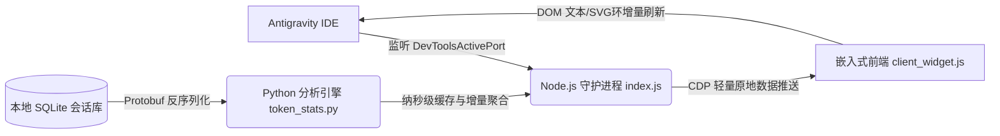

# ⚡ Antigravity Tokens & Performance HUD

<p align="center">
  <strong>专为 Google Antigravity 打造的原生风实时速度、上下文缓存命中率与 Token 活动热力监控面板</strong><br>
  <em>Real-time generation speed, context caching hit rate, and activity heatmap HUD for Google Antigravity 2.0.</em>
</p>

<p align="center">
  
  
  
  
</p>

---

## ✨ 核心特性 / Features

* ⚡ **真实端到端生成速度（True TPS）**  
  结合 `steps.metadata` 纳秒级单步时间戳与 `gen_metadata` 重试隔离解析，清晰分离**首字延迟（TTFT，含排队与预填充）**与**流式输出耗时（Streaming Duration）**，彻底消除内部工具重试累加导致的千级虚高假速度与上下文翻倍误差。
* 🧠 **精确自动压缩阈值圆环与缓存命中率（Compaction Ring & Cache Hit）**  
  直接从底层 `ContextWindowMetadata`（`cfn10.f4`）读取 Antigravity 为各模型设定的**真实自动压缩阈值**（如常规 Gemini `256k`、`Argon-D` `512k`、`Claude Opus 5.5` `840k`、`Claude 4.6` `160k`），以极简的 `已用/阈值 百分之 ◯`（如 `199.0k/256k 77.7% ◯`）配合三色预警进度圆环提前提示 `<CONTEXT_SUMMARY>` 自动压缩临界点；同时支持手动 `/compact` 检查点（`step_type=23`）实时回落与压缩次数（`已压缩 N次`）精准追踪。
* 📅 **25 周紧凑型「Token 活动」热力矩阵（Activity Heatmap）**  
  无缝还原 Antigravity 原生「Token 活动」体验：
  * **每天视图**：25 周（175 天）高密度 Google 蓝贡献方块，鼠标悬停展示精确日期与 Token 数量 Tooltip；
  * **每周视图**：近 12 周使用量直方分布柱；
  * **累计总量**：提示词输入、生成输出、深度思考与上下文缓存细分统计。
* 🎨 **原生深色主题对齐（Native Onyx Aesthetics）**  
  完全移除突兀的浮动药丸/气泡框，不重复展示原生已有的配额面板，与 Antigravity 底栏模型选择器（`button[data-testid="model-selector-trigger"]`）保持 100% 相同字号、间距与幽灵悬浮交互质感。
* 🔒 **100% 纯本地只读，零云端 RPC 请求（Zero RPC / Safe IPC）**  
  不触碰 React Fiber 内部客户端，不对 Google 云端发起任何 RPC 或网络请求，不收集账号密码或凭据，仅在本地对话 SQLite 数据库实际变更时增量解析，挂机闲置零开销、零风控风险。

---

## 📸 界面预览 / Preview

### 底栏集成（紧贴模型选择器）
```text
[ Gemini 3.8 Flash 高 ^ ]  [ ⚡ 69.5 tok/s  146.5k/256k 57.2% ◯ ⌄ ]
```

### 展开详情面板（极简原生暗黑风）
```text
┌────────────────────────────────────────────────────────┐
│ 用量与性能                                      ✕ 关闭 │
├────────────────────────────────────────────────────────┤
│ 实时性能                                               │
│ 生成速度               最近: 2828 tok · 40.7s  69.5 tok/s│
│ 会话平均速度            (21轮 · 峰值 80.9)     45.3 tok/s│
│ 当前上下文 (压缩阈值) [已压缩 1次]      146.5k/256k 57.2% ◯│
│ 上下文缓存命中率 [Cache]      (会话总计 88.5%)    97.3%│
├────────────────────────────────────────────────────────┤
│ Token 活动                             每天  每周  累计总量 │
│ ■■■■■■■■■■■■■■■■■■■■■■■■■                              │
│ ■■■■■■■■■■■■■■■■■■■■■■■■■                              │
│ ■■■■■■■■■■■■■■■■■■■■■■■■■                              │
│ 6月      7月      8月      9月      10月     11月      │
├────────────────────────────────────────────────────────┤
│ 近期消耗                                新增 / 总吞吐 (命中)│
│ 5小时已消耗           338.6万 / 3290.6万 (90%) (273次) │
│ 本周已消耗             2011.2万 / 2.97亿 (94%) (2422次)│
│ 历史累计总耗           7370.9万 / 11.13亿 (94%) (51会话)│
└────────────────────────────────────────────────────────┘
```

---

## 🚀 极速安装 / Quick Start

### 🪟 Windows (PowerShell)
以普通用户身份打开 PowerShell，执行一键安装脚本（自动配置开机静默后台常驻）：
```powershell
irm https://raw.githubusercontent.com/malie2f/antigravity-tokens-hud/main/install.ps1 | iex
```

### 🍎 macOS / 🐧 Linux (Bash)
打开终端执行：
```bash
curl -fsSL https://raw.githubusercontent.com/malie2f/antigravity-tokens-hud/main/install.sh | bash
```

### 📦 手动安装 / 本地开发
```bash
# 1. 克隆代码仓库
git clone https://github.com/malie2f/antigravity-tokens-hud.git
cd antigravity-tokens-hud

# 2. 运行后台守护进程
node index.js
```

---

## 🛠️ 工作原理 / How It Works



1. **自动 DevTools 端口探测**：通过监听用户数据目录下的 `DevToolsActivePort`，自动定位 Antigravity 渲染进程 WebSocket。
2. **底层 SQLite 增量聚合**：通过 Python 反序列化 `steps` 表与 `gen_metadata` 表中的原生 Protobuf 数据（`exa.cortex_pb.CortexStepGeneratorMetadata`），严格根据 `stepIndices` 映射时间戳，精准提取提示词、生成输出、深度思考以及缓存读写量。
3. **按需增量触发与原地无损推送（In-Place DOM Push）**：守护进程仅在本地会话数据库（`.db` / `.db-wal`）发生文件变更时才调用分析脚本，并通过 `window.__AGY_HUD_PUSH__(data)` 钩子**仅定向更新数字节点与上下文 SVG 进度圆环，绝不重置弹窗状态**，确保闲置零开销、弹窗稳定常驻打开。

---

## ⚙️ 环境依赖 / Prerequisites

* **Node.js**：`v18.0.0` 或更高版本（Node 22+ 原生支持 WebSocket，低版本支持自动降级 `ws`）
* **Python**：`3.9` 或更高版本（内置标准库 `sqlite3`、`json`、`datetime`，无需安装额外第三方 pip 包）
* **Google Antigravity**：支持 Antigravity 2.0 及更高版本

---

## 🗑️ 卸载指南 / Uninstallation

如果您需要完全移除本插件：

* **Windows**：运行 `~/.antigravity-tokens-hud/uninstall.ps1`，或执行：
  ```powershell
  & "$env:USERPROFILE\.antigravity-tokens-hud\uninstall.ps1"
  ```
* **macOS / Linux**：运行：
  ```bash
  bash ~/.antigravity-tokens-hud/uninstall.sh
  ```

---

## 📄 开源许可证 / License

本项目基于 [MIT License](LICENSE) 许可协议开源。
欢迎提交 Issue 与 Pull Request 共同完善！
